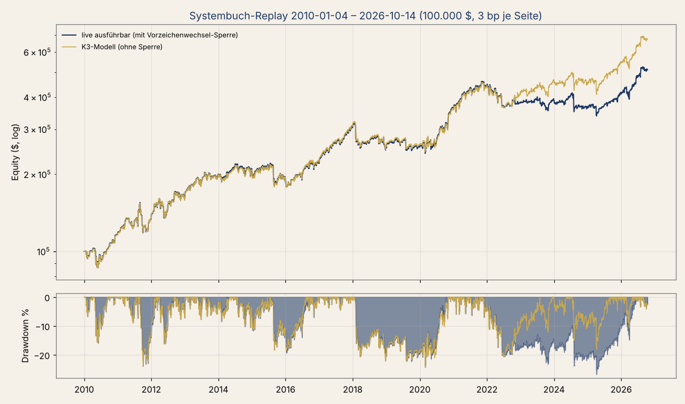
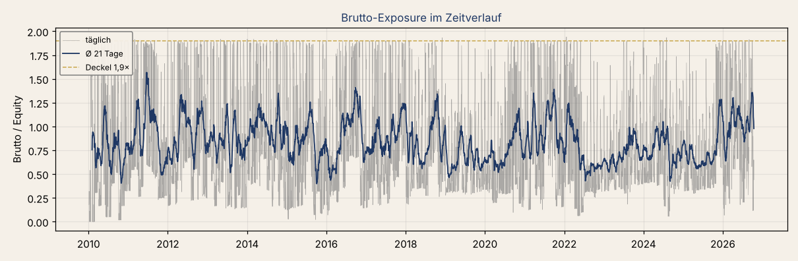

# Replay Systembuch 2010-01-04 – 2026-10-14

*Erzeugt 15.10.2026 mit `python3 systembuch_bot.py --replay 2010-01-01 2026-10-14`. Yahoo-Tageskurse, Start 100.000 $, Kosten 3 bp je Seite auf das Netto-Volumen je Symbol, Leihbarkeit: Alpaca /v2/assets (Paper). Dieselbe Entscheidungsfunktion wie live (`kern.entscheide`, `kern.netto_orders`).*

Zwei Modelle, sonst identisch: **live** = so, wie der Bot bei Alpaca handeln kann (Vorzeichenwechsel-Sperre: ein Symbol dreht an einem Tag nie durch null, Review 3.2). **K3-Modell** = ohne Sperre, methodisch gleich dem unabhängigen Replay K3 – an ihm wird die Plausibilität geprüft.

## Plausibilität gegen K3 (SPEC Punkt 4)

| Kennzahl | K3 | K3-Modell | Abw. | Prüfung | live | Abw. |
|---|---|---|---|---|---|---|
| **Rendite p.a.** | +12,0 % | +12,0 % | +0 % | ok | +10,2 % | -15 % |
| Schwankung | +17,0 % | +17,0 % | +0 % | ok | +16,2 % | -5 % |
| **Sharpe** | 0,75 | 0,75 | +1 % | ok | 0,68 | -9 % |
| Sortino | 1,07 | 1,08 | +1 % | ok | 0,97 | -9 % |
| **Maximalverlust** | 24,1 % | 24,1 % | -0 % | ok | 26,7 % | +11 % |
| Endwert $ | 669.000 | 671.989 | +0 % | ok | 511.141 | -24 % |
| Kosten gesamt $ | 208.600 | 211.054 | +1 % | ok | 171.959 | -18 % |
| Trades p.a. | 745 | 746 | +0 % | ok | 794 | +7 % |
| Ø offene Legs | 14,5 | 14,5 | -0 % | ok | 16,0 | +10 % |
| Beta zu SPY | 0,74 | 0,74 | +1 % | ok | 0,69 | -7 % |
| **Beitrag IBS p.a.** | +3,8 % | +3,8 % | +0 % | ok | +2,5 % | -33 % |
| Beitrag Monatswechsel p.a. | +1,6 % | +1,6 % | -0 % | ok | +1,4 % | -12 % |
| Beitrag BB-Rückkehr p.a. | +1,6 % | +1,6 % | +2 % | ok | +1,7 % | +5 % |
| Beitrag IBS-Sektor p.a. | +0,3 % | +0,3 % | +10 % | ok | +0,4 % | +20 % |
| **Beitrag IBS-Land p.a.** | +1,7 % | +1,7 % | -2 % | ok | +1,6 % | -6 % |
| Beitrag TSMOM p.a. | +0,5 % | +0,5 % | -7 % | ok | +0,4 % | -21 % |
| Beitrag Monatswechsel-Land p.a. | +0,6 % | +0,6 % | -4 % | ok | +0,3 % | -51 % |
| **Beitrag VIX-Contango p.a.** | +2,8 % | +2,8 % | -1 % | ok | +2,8 % | -1 % |
| Tresor ab 02.10.2023 p.a. | +17,1 % | +16,8 % | -2 % | ok | +11,5 % | -33 % |
| Tresor Sharpe | 1,06 | 1,05 | -1 % | ok | 0,87 | -18 % |
| Tresor Maximalverlust | 18,1 % | 18,1 % | +0 % | ok | 18,8 % | +4 % |
| Variante ohne_tsmom | +11,4 % | +11,5 % | +1 % | ok | +11,4 % | +0 % |
| Variante ohne_vix | +10,0 % | +10,1 % | +1 % | ok | +8,1 % | -19 % |
| Variante ohne_mw_land | +10,1 % | +10,6 % | +5 % | ok | +10,0 % | -1 % |
| Variante nur_ibs_familie | +7,9 % | +7,9 % | +1 % | ok | +7,9 % | +1 % |
| IBS allein p.a. | +5,0 % | +5,0 % | +0 % | ok | +5,0 % | +0 % |
| VIX allein p.a. | +3,1 % | +3,1 % | +0 % | ok | +3,1 % | +0 % |
| IBS allein Sharpe | 0,63 | 0,63 | -0 % | ok | 0,63 | -0 % |
| TSMOM allein Sharpe | 0,54 | 0,54 | +1 % | ok | 0,53 | -1 % |
| nur IBS-Familie Sharpe | 0,73 | 0,73 | -0 % | ok | 0,73 | -0 % |
| nur IBS-Familie Maximalverlust | 18,3 % | 18,3 % | -0 % | ok | 18,3 % | -0 % |
| Korrelation IBS/IBS-Land | 0,63 | 0,63 | +1 % | ok | 0,63 | -1 % |
| Korrelation MW/MW-Land | 0,72 | 0,72 | +1 % | ok | 0,73 | +2 % |

Fett = Kennzahl, bei der laut SPEC eine Abweichung über 15 % Fehlersuche heißt (Linus' Regel 7: über 30 %). Geprüft wird das K3-Modell; die Spalte „live“ weicht nur wegen der Vorzeichenwechsel-Sperre ab (Abschnitt „Preis der Sperre“).

- **live:** Maximalverlust 26,7 % vom Höchststand 2021-11-15 bis 2025-04-08 (851 Handelstage), neues Hoch 2026-06-11 (1146 Handelstage ab Höchststand; K3: Tief 28.02.2020, 702). Alpha zu SPY +0,9 % p.a. (t 0,33), investiert an 100 % der Tage, Ø Brutto 0,84× (max 1,94×), Bremse an 32 % der Tage, 56 BB-Stopps, 227 BB-Leg-Tage ohne Stop (Wash-Trade-Lücke).
- **K3-Modell:** Maximalverlust 24,1 % vom Höchststand 2018-01-22 bis 2020-02-28 (529 Handelstage), neues Hoch 2020-11-04 (703 Handelstage ab Höchststand; K3: Tief 28.02.2020, 702). Alpha zu SPY +1,8 % p.a. (t 0,66), investiert an 100 % der Tage, Ø Brutto 0,90× (max 1,95×), Bremse an 16 % der Tage, 59 BB-Stopps.

## Jahresrenditen

| Jahr | live | K3-Modell | K3 |
|---|---|---|---|
| 2010 | +16,4 % | +15,8 % | +15,8 % |
| 2011 | +15,5 % | +16,6 % | +16,9 % |
| 2012 | +21,9 % | +21,1 % | +21,0 % |
| 2013 | +22,1 % | +22,0 % | +22,2 % |
| 2014 | +1,8 % | +1,3 % | +0,2 % |
| 2015 | -6,6 % | -6,2 % | -6,2 % |
| 2016 | +15,6 % | +17,2 % | +16,9 % |
| 2017 | +37,9 % | +38,1 % | +38,0 % |
| 2018 | -15,4 % | -15,6 % | -15,6 % |
| 2019 | -0,1 % | +0,8 % | +0,7 % |
| 2020 | +42,3 % | +38,5 % | +38,5 % |
| 2021 | +21,2 % | +21,2 % | +21,4 % |
| 2022 | -14,0 % | -4,9 % | -4,4 % |
| 2023 | +2,8 % | +11,9 % | +11,7 % |
| 2024 | -7,1 % | -3,4 % | -3,2 % |
| 2025 | +13,1 % | +20,2 % | +20,2 % |
| 2026 | +24,4 % | +24,1 % | +24,2 % |

## Beitrag je Strategie (live)

| Strategie | Beitrag p.a. | (K3-Modell) | Sharpe | Summe $ | Trades | je Jahr | Treffer | Ø bp je Trade | t (Trade) | Ø Haltetage | Ø Brutto |
|---|---|---|---|---|---|---|---|---|---|---|---|
| IBS | +2,5 % | +3,8 % | 0,44 | 91.772 | 2294 | 137 | 57 % | 15,3 | 4,7 | 1,2 | 0,13 |
| Monatswechsel | +1,4 % | +1,6 % | 0,24 | 47.400 | 791 | 47 | 57 % | 25,9 | 3,3 | 3,9 | 0,15 |
| BB-Rückkehr | +1,7 % | +1,6 % | 0,43 | 74.542 | 215 | 13 | 69 % | 62,2 | 3,0 | 7,2 | 0,08 |
| IBS-Sektor | +0,4 % | +0,3 % | 0,23 | 19.628 | 1516 | 91 | 56 % | 5,9 | 1,6 | 1,3 | 0,04 |
| IBS-Land | +1,6 % | +1,7 % | 0,63 | 63.341 | 4612 | 275 | 56 % | 13,3 | 5,4 | 1,2 | 0,08 |
| TSMOM | +0,4 % | +0,5 % | 0,24 | 14.995 | 2130 | 127 | 53 % | 13,6 | 1,2 | 19,8 | 0,24 |
| Monatswechsel-Land | +0,3 % | +0,6 % | 0,12 | -4.408 | 1660 | 99 | 55 % | 22,5 | 3,2 | 4,0 | 0,05 |
| VIX-Contango | +2,8 % | +2,8 % | 0,61 | 103.872 | 80 | 5 | 34 % | 636,6 | 2,2 | 41,4 | 0,08 |

Beitrag p.a. = Ø tägliches Ergebnis der Strategie / Vortages-Equity × 252. Ø bp je Trade nach Kosten. t = Mittelwert / Standardfehler der Trade-Renditen. K3-Referenz: IBS 2 245 Trades, +16 bp, t 5,0 · IBS-Land 4 507 Trades, t 5,2 · BB 208 Trades, Treffer 68 % · VIX 80 Trades, Treffer 34 %.

## Korrelation der Strategie-Tagesrenditen (live)

| | IBS | Monatswechsel | BB-Rückkehr | IBS-Sektor | IBS-Land | TSMOM | Monatswechsel-Land | VIX-Contango |
|---|---|---|---|---|---|---|---|---|
| IBS | 1,00 | 0,12 | 0,24 | 0,08 | 0,63 | 0,18 | 0,09 | 0,21 |
| Monatswechsel | 0,12 | 1,00 | 0,14 | 0,11 | 0,12 | 0,06 | 0,73 | 0,21 |
| BB-Rückkehr | 0,24 | 0,14 | 1,00 | 0,13 | 0,23 | 0,19 | 0,04 | 0,23 |
| IBS-Sektor | 0,08 | 0,11 | 0,13 | 1,00 | 0,28 | 0,07 | 0,08 | 0,16 |
| IBS-Land | 0,63 | 0,12 | 0,23 | 0,28 | 1,00 | 0,20 | 0,11 | 0,25 |
| TSMOM | 0,18 | 0,06 | 0,19 | 0,07 | 0,20 | 1,00 | 0,02 | 0,11 |
| Monatswechsel-Land | 0,09 | 0,73 | 0,04 | 0,08 | 0,11 | 0,02 | 1,00 | 0,13 |
| VIX-Contango | 0,21 | 0,21 | 0,23 | 0,16 | 0,25 | 0,11 | 0,13 | 1,00 |

## Varianten (SPEC Aufgabe 3: was die Experimente kosten oder bringen)

| Variante | live p.a. | Sharpe | Maximalverlust | K3-Modell p.a. | Sharpe | Maximalverlust | K3 p.a. |
|---|---|---|---|---|---|---|---|
| Gesamtbuch | +10,2 % | 0,68 | 26,7 % | +12,0 % | 0,75 | 24,1 % | +12,0 % |
| ohne_tsmom | +11,4 % | 0,72 | 25,9 % | +11,5 % | 0,72 | 26,2 % | +11,4 % |
| ohne_vix | +8,1 % | 0,61 | 24,9 % | +10,1 % | 0,69 | 23,9 % | +10,0 % |
| ohne_mw_land | +10,0 % | 0,69 | 25,4 % | +10,6 % | 0,72 | 23,3 % | +10,1 % |
| nur_ibs_familie | +7,9 % | 0,73 | 18,3 % | +7,9 % | 0,73 | 18,3 % | +7,9 % |
| ibs_allein | +5,0 % | 0,63 | 12,8 % | +5,0 % | 0,63 | 12,8 % | – |
| tsmom_allein | +1,7 % | 0,53 | 7,7 % | +1,7 % | 0,54 | 7,9 % | – |
| vix_allein | +3,1 % | 0,60 | 7,6 % | +3,1 % | 0,60 | 7,6 % | – |
| vix_vortag | +9,3 % | 0,64 | 30,2 % | +11,1 % | 0,71 | 23,9 % | – |

## Tresor ab 02.10.2023

- live: +11,5 % p.a., Sharpe 0,87, Maximalverlust 18,8 % (Tief 2025-04-08).
- K3-Modell: +16,8 % p.a., Sharpe 1,05, Maximalverlust 18,1 % (Tief 2025-04-08).
- K3: +17,1 % p.a., Sharpe 1,06, Maximalverlust 18,1 % (08.04.2025).

## Preis der Vorzeichenwechsel-Sperre

Ohne Sperre +12,0 % p.a., mit Sperre nur long→short +12,1 %, mit Sperre in beide Richtungen (live) +10,2 %. 591 Symbol-Tage hätten durch null gedreht; 312 Teile mehrtägiger Strategien wurden am Folgetag nachgeholt, 290 IBS-Teile sind verfallen. Fast die ganze Differenz kommt aus der Kaufseite (short → long): TSMOM ist in Abwärtsphasen short SPY/QQQ/IWM/EEM, genau dann kauft IBS dieselben ETFs – und IBS verdient in Abwärtsphasen am meisten. Die Sperre kappt so die besten IBS-Trades (z. B. QQQ 09.11.2022: 13 statt ≈ 300 Stück vor dem CPI-Tag), das Konto fällt 2022 tiefer, die Bremse (×0,5) greift 2023–2025 an den meisten Tagen. Siehe replay/BEOBACHTUNGEN.md.

## Modell und bewusste Abweichungen zu K3

- Kennzahlen wie live: Historie relativ zum Entscheidungstag bereinigt (Alpaca `adjustment=all`); dadurch ATR aus der bereinigten statt der Rohreihe (K3: roh). Unterschied nur an Ex-Tagen.
- Live-Modell mit Vorzeichenwechsel-Sperre (Review 3.2); K3-Modell ohne.
- BB-Stop ab t0+2 intraday, Fill min(Eröffnung, Stop) – wie K3 (live wird der Stop schon am Ende von t0+1 gesetzt; nicht abgebildet).
- SVXY handelbar ab 60 Handelstagen Historie (29.12.2011, Bedingung in `kern.kennzahlen`, live immer erfüllt). Das trifft K3 genau (80 VIX-Trades, 2012 +21 %); ab Auflage 04.10.2011 wären es 83 Trades, VIX-Beitrag 2,4 statt 2,8 Punkte (BEOBACHTUNGEN 2).
- VIX-Contango entscheidet mit dem Yahoo-Schluss von ^VIX/^VIX3M (CBOE 16:15 ET), live um 15:45. Variante `vix_vortag` (Vortagesschluss) zeigt die pessimistische Schranke.
- Fill = Schlusskurs. Die MOC-Abweichung misst der Live-Bot im Journal (`abweichung_bp`). K6 (Signal 15:45 statt Schluss) ist nicht enthalten: Erwartung IBS ≈ −0,4, IBS-Land ≈ −0,6 Punkte p.a. (README).
- Stückzahl aus Yahoos `close` (nur split-bereinigt) wie K3: Bei UNG/USO war der echte Kurs 2010–2012 viel niedriger, der Replay rundet dort gröber als live (≤ 0,16 Punkte p.a., BEOBACHTUNGEN 5).
- Keine Leihkosten, keine Zinsen (wie K3).
